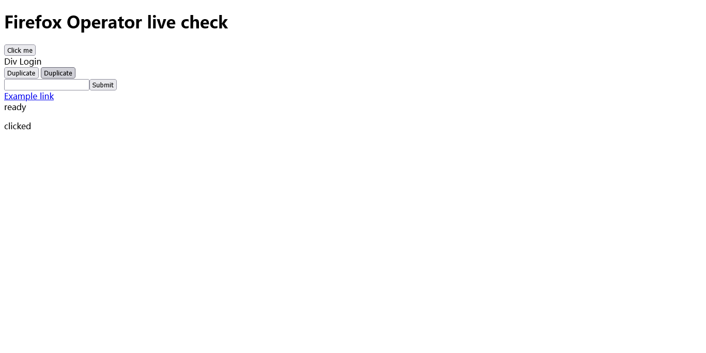

# dsh-firefox-operator

> 让 **DeepSeek Harness（dsh）** 通过 Firefox 内置的 **WebDriver BiDi** 操控浏览器 —— 不需要 Firefox 扩展、不需要签名 XPI、不需要 native messaging host。

这是一个 dsh Host 插件。安装后，agent 会多出 10 个 `firefox_*` 工具，可以启动/连接 Firefox、开关标签页、导航、读取页面内容与 DOM、截图、点击、填表、执行页面 JavaScript、等待元素。

---

## 特性

- **10 个浏览器工具**，覆盖标签页生命周期、导航、读取、截图、交互、等待。
- **真实鼠标点击**：按 selector 或可见文字点击，优先派发可信鼠标事件；协议不支持时回退 DOM click。
- **智能文本匹配**：覆盖语义控件与 `cursor:pointer` 的 div/span；精确匹配优先，多义时返回候选列表而不是乱点。
- **零运行时依赖**：只用 Node.js 内置模块与全局 `WebSocket`，无 `ws`、无 Playwright/Puppeteer。
- **稳定的错误模型**：每个失败都带稳定错误码、可读原因与下一步建议，错误不会拖垮 Firefox 或 dsh。
- **串行命令队列**：所有操作串行化在一条 BiDi 协议流上，避免并发踩踏标签页/会话状态。
- **Windows 友好**：默认通过 WMI 启动 Firefox，绕过 dsh Host 的 job/受限环境导致的 content 进程启动失败。

## 架构

```text
dsh agent
  └─ firefox_* 工具              index.js / lib/tools.js
       └─ FirefoxOperator        lib/firefox.js   生命周期、标签页、页面操作
            └─ BidiClient        lib/bidi-client.js  WebSocket、请求 id、超时、断线
                 └─ ws://127.0.0.1:<port>/session
                      └─ Firefox 内置 WebDriver BiDi remote agent
```

Firefox 侧没有本仓库的代码：它由 `--remote-debugging-port` 开启自带的 remote agent，本仓库只作为 BiDi 客户端。

## 环境要求

| 依赖 | 要求 |
| --- | --- |
| dsh | `>= 0.2.1-rc.5`（Host 插件接口） |
| Firefox | 153 ESR（内置 WebDriver BiDi） |
| Node.js | `>= 22`（使用内置全局 `WebSocket`） |
| 平台 | 在 Windows 10 x64 上实测；Linux/macOS 使用 `launchMode: direct`，未在仓库内实测 |

## 安装

### 方式一：命令行（link 安装）

```powershell
git clone https://github.com/Tan-Xiuyuan/dsh-firefox-opreator.git
cd dsh-firefox-opreator
dsh plugin add link:<本仓库绝对路径>
```

### 方式二：dsh Web GUI

插件管理 → 安装 bundle → 选择本仓库目录 → 安装结果应为 `application: applied`。

> 安装或更新后必须**重启 dsh Host 进程**。只新开会话不会重新加载插件清单，尤其当工具数量或 schema 变化时。

## 快速开始

对 dsh 说：

> 用 `firefox_launch` 以 headless 启动 Firefox，用 `firefox_navigate` 打开 `https://example.com/`，用 `firefox_read` 读取标题和正文，最后 `firefox_screenshot` 截图。

等价的工具调用：

```json
{"name":"firefox_launch","arguments":{"headless":true}}
{"name":"firefox_navigate","arguments":{"url":"https://example.com/"}}
{"name":"firefox_read","arguments":{}}
{"name":"firefox_screenshot","arguments":{"format":"png"}}
```

`firefox_launch` 的典型返回（端口、PID、tab id 每次不同）：

```json
{
  "connected": true,
  "port": 5724,
  "browser": "firefox",
  "external": false,
  "firefoxPid": 20824,
  "launchMethod": "wmi",
  "activeTabId": "92adb53e-...",
  "tabs": [{"tabId":"92adb53e-...","url":"about:blank","title":"","type":"tab"}],
  "launched": true,
  "alreadyConnected": false
}
```

`firefox_screenshot` 会返回绝对路径，可直接交给 `read_image` 查看。仓库内示例产物：



### 连接自己启动的 Firefox

```powershell
& "C:\Program Files\Mozilla Firefox\firefox.exe" `
  --remote-debugging-port=9222 `
  --profile "$env:TEMP\ff-dsh-profile" `
  --no-remote --new-instance
```

```json
{"name":"firefox_launch","arguments":{"attach_only":true,"port":9222}}
```

> 一个 Firefox 实例同时只允许一个 BiDi 会话。若已有其它客户端，Firefox 会拒绝并返回 `Maximum number of active sessions`。
> 用 `firefox_close({"target":"disconnect"})` 正常释放会话；直接杀掉 WebSocket 会留下会话，导致下次连接失败。

## 工具

| 工具 | 作用 | 主要参数 |
| --- | --- | --- |
| `firefox_launch` | 启动 Firefox 或连接已开启 remote agent 的实例 | `url`、`headless`、`port`、`attach_only`、`wait_until` |
| `firefox_tabs` | 列出/新建/切换/关闭标签页 | `action`、`tab_id`、`url`、`wait_until` |
| `firefox_navigate` | 导航到绝对 URL 并等待加载状态 | `url*`、`tab_id`、`new_tab`、`wait_until`、`timeout_ms` |
| `firefox_read` | 读取标题、URL、正文、链接，可选 DOM HTML | `tab_id`、`selector`、`include_html`、`max_chars` |
| `firefox_screenshot` | 截取可视区域并保存为 PNG/JPEG | `tab_id`、`format` |
| `firefox_click` | 按 selector 或可见文字点击 | `selector` 或 `text`、`index`、`tab_id` |
| `firefox_fill` | 填写表单控件，可选提交 | `selector*`、`value*`、`submit`、`tab_id` |
| `firefox_eval` | 在页面上下文执行 JavaScript | `expression*`、`await_promise`、`tab_id` |
| `firefox_wait` | 等待元素状态或 `document.readyState` | `selector`、`state`、`load_state`、`timeout_ms`、`tab_id` |
| `firefox_close` | 关闭标签页 / 断开连接 / 关闭 Firefox | `target`、`tab_id` |

`*` 表示必填；`tab_id` 省略时作用于当前活动标签页。

## 配置

所有配置项均可省略，默认值开箱可用。推荐在 profile 的用户 patch 层
`<DSH_PROFILE_DIR>\cordis.patch.yml` 中覆盖（同一 `id` 覆盖 bundle 内配置）：

```yaml
- id: dsh-firefox-operator
  config:
    headless: false
    port: 0
    launchMode: auto
```

| 配置项 | 默认值 | 说明 |
| --- | --- | --- |
| `firefoxPath` | 自动探测 | `firefox.exe` 的绝对路径 |
| `profileDir` | `%LOCALAPPDATA%\dsh-firefox-operator\firefox-profile` | 专用 profile 目录；插件会写入 BiDi 所需 prefs |
| `port` | `0` | `0` 自动选空闲回环端口；也可固定端口 |
| `headless` | `true` | 是否无窗口启动 |
| `connectExisting` | `true` | 已运行时复用已有连接 |
| `attachOnly` | `false` | 只连接、不启动 |
| `launchTimeoutMs` | `30000` | 等待 remote agent 就绪的上限 |
| `commandTimeoutMs` | `20000` | 单条 BiDi 命令超时 |
| `navigationTimeoutMs` | `60000` | 导航默认超时 |
| `defaultWaitMs` | `10000` | `firefox_wait` 默认超时 |
| `maxReadChars` | `30000` | 读取返回字符上限（最大 200000） |
| `screenshotDir` | `%TEMP%\dsh-firefox-operator\screenshots` | 截图输出目录 |
| `launchMode` | `auto` | `auto` / `wmi` / `direct`，仅 Windows 生效 |
| `killOnDispose` | `true` | 插件卸载时结束会话并关闭由插件启动的 Firefox |

也可用 Host 进程环境变量覆盖：

| 环境变量 | 对应配置 |
| --- | --- |
| `DSH_FIREFOX_PATH` / `FIREFOX_PATH` | `firefoxPath` |
| `DSH_FIREFOX_PROFILE` | `profileDir` |
| `DSH_FIREFOX_PORT` | `port` |
| `DSH_FIREFOX_HEADLESS` | `headless` |
| `DSH_FIREFOX_SCREENSHOT_DIR` | `screenshotDir` |
| `DSH_FIREFOX_LAUNCH_MODE` | `launchMode` |

## 设计要点

- **单会话、单队列**：一个 Firefox 只有一个 BiDi 会话，所有命令串行执行；工具调用并发时自动排队。
- **生命周期自洽**：`session.new` 只做一次；`disconnect` 与插件卸载都会发送 `session.end`，避免 "Maximum number of active sessions" 锁死。
- **就绪探测不依赖 HTTP**：Firefox 153 ESR 的 `/json/version` 会接受 TCP 连接却不返回响应，因此只等 TCP 端口，然后直接对 `/session` 做 WebSocket 握手（握手本身有超时与重试）。
- **错误可诊断**：所有错误带稳定错误码（如 `FIREFOX_NOT_FOUND`、`CONNECT_TIMEOUT`、`NO_SUCH_TAB`、`WAIT_TIMEOUT`、`AMBIGUOUS_TEXT`），并尽量附带 hint。
- **Windows 进程逃逸**：`launchMode: auto` 在 Windows 上优先用 WMI `Win32_Process.Create` 启动 Firefox，让浏览器脱离 dsh Host 的 job；失败回退直接 spawn。返回的 `launchMethod` 表明实际路径。
- **取消即返回**：工具接收 `exec.signal`，被取消时尽快结束并清理。

## 故障排查

| 现象 | 处理 |
| --- | --- |
| `FIREFOX_NOT_FOUND` | 设置 `firefoxPath` 或 `FIREFOX_PATH` 为 `firefox.exe` 完整路径 |
| `FIREFOX_EXITED` 且 stderr 含 `@SB::LA::SpawnTarget` | Host 的 job/受限令牌阻断了 content 进程；保持 `launchMode: auto`（WMI 优先）并重启 dsh Host |
| `FIREFOX_START_TIMEOUT` | profile 可能被其它 Firefox 占用；改用专用 profile，并查看错误附带的 stderr |
| `CONNECT_TIMEOUT` | Firefox 启动早期常见，插件会重试；确认端口确实属于 Firefox |
| `PORT_IN_USE` | 换端口或使用 `port: 0` 自动分配 |
| `Maximum number of active sessions` | 另一个 BiDi 客户端仍持有会话；结束它或重启 Firefox |
| `NO_SUCH_TAB` | 用 `firefox_tabs(action:"list")` 取最新 `tab_id`；导航/关闭后旧 id 失效 |
| `WAIT_TIMEOUT` | 增大 `timeout_ms`，或先用 `firefox_read` 确认页面实际状态 |
| 在 dsh 受限 shell 内启动 Firefox 无响应 | 用插件工具（Host 进程）启动，或在沙箱外终端启动后用 `attach_only` 连接 |
| 安装报 `ERR_PNPM_UNEXPECTED_STORE` | profile 的 pnpm store 与现有 `node_modules` 不一致；按 `node_modules\.modules.yaml` 的 `storeDir` 对齐全局 `store-dir` 后重试，不要手改 profile 的 `package.json` |

## 安全与限制

- **`firefox_eval` 执行任意页面 JavaScript**：只对可信页面使用，不要把页面返回内容当作指令执行。
- **remote agent 无认证**：默认只监听回环地址；不要把 `--remote-debugging-port` 暴露到公网或不可信网络。
- **专用 profile**：默认 profile 与日常 Firefox 隔离；若要复用登录态，请显式配置 `profileDir`，并理解 agent 将拥有该 profile 的控制权。
- **截图可能包含敏感内容**：默认写入系统临时目录，按需配置 `screenshotDir` 并定期清理。
- **大整数精度**：BiDi 数值为 IEEE-754 double，超过 `2^53` 的整数在 JSON 往返中会失真，ID/金额建议以字符串返回。
- **未实现**：下载、文件选择器、扩展管理、iframe 内部独立上下文切换、console/network 事件缓冲、基于 sharedId 的元素引用。

## 开发与测试

```powershell
npm test                          # 单元/集成测试（进程内真实 WebSocket 的 BiDi mock）
node scripts/live-check.mjs       # 真实 Firefox 端到端验证
node scripts/minimal-example.mjs https://example.com/   # 最小命令行示例
```

`live-check` 覆盖启动/连接、导航、读取、截图、真实鼠标点击、文本点击、多义文本候选、填表提交、页面 eval、等待、标签页增删切换、错误返回与错误后恢复。

## 项目结构

```text
.
├─ index.js                 # Host 插件入口：inject=['tools']、注册工具、卸载清理
├─ cordis.patch.yml         # dsh bundle 安装入口
├─ lib/
│  ├─ firefox.js            # FirefoxOperator：启动/连接、标签页、导航、读取、截图、点击、填表、eval、等待
│  ├─ bidi-client.js        # BiDi WebSocket 客户端：会话、请求 id、错误、超时、断线
│  ├─ tools.js              # 10 个工具的参数/输出 schema、描述与渲染
│  └─ errors.js             # 稳定错误码与 WebDriver 错误映射
├─ locale/{en,zh}.json      # 插件管理器显示名/描述
├─ scripts/                 # live-check 与最小示例
├─ test/                    # mock BiDi 服务器与测试
└─ docs/                    # PROTOCOL.md、VERIFICATION.md、示例截图
```

## 许可证

[MIT](LICENSE)
